<h1 align="center">Yagho Mattos</h1>

  

  
  
  

  <a href="https://www.linkedin.com/in/yaghomattos/">LinkedIn</a> ·
  <a href="mailto:mattosyagho@gmail.com">E-mail</a> ·
  Juiz de Fora, MG

---

Formado em **Ciência da Computação** e **Ciências Exatas** pela **UFJF**. Trabalho numa empresa de contabilidade, onde entrei como estagiário de TI. Hoje desenvolvo as automações e ferramentas internas, presto suporte aos usuários e aos clientes da contabilidade e, desde 2026, também respondo pela infraestrutura: servidores, e-mail, rede, Wi-Fi, estações e nobreaks.

### O que faço

<table>
  <tr>
    <td width="50%" valign="top">
      <h4>🐍 Automação & Desenvolvimento</h4>
      
Robôs e ferramentas que tiram trabalho manual da rotina da empresa.

      <ul>
        <li><b>Selenium</b> e <b>Playwright</b> para automação web</li>
        <li><b>BotCity</b>, <b>PyAutoGUI</b> e <b>pywinauto</b> para automação desktop</li>
        <li>Manipulação de arquivos em lote</li>
        <li>Integrações via <b>APIs</b> e proxies de API próprios</li>
        <li>Ferramentas internas com <b>Streamlit</b></li>
        <li>Exposição de serviços com <b>ngrok</b> e <b>Cloudflare</b></li>
      </ul>
    </td>
    <td width="50%" valign="top">
      <h4>🌐 Infraestrutura desde 2026</h4>
      
Servidores, rede, e-mail e estações funcionando no dia a dia.

      <ul>
        <li><b>Active Directory</b>: usuários, permissões e GPOs</li>
        <li>Virtualização com <b>Hyper-V</b>, <b>VMware</b> e <b>VirtualBox</b>; ambientes com <b>WSL</b> e <b>Docker</b></li>
        <li>Rede e firewall <b>MikroTik</b> (Winbox)</li>
        <li>E-mail corporativo no <b>Zoho Mail</b></li>
        <li>Proteção das estações com <b>Bitdefender GravityZone</b></li>
        <li>Acesso remoto com <b>MeshCentral</b> e <b>Sysinternals</b>, scripts em lote em Python e <b>.bat</b></li>
      </ul>
    </td>
  </tr>
  <tr>
    <td colspan="2">
      🔐 <b>Agora:</b> estudando <b>Cibersegurança e Governança de TI</b> para aplicar na administração do ambiente e no desenvolvimento de software.
    </td>
  </tr>
</table>

### Trajetória

  

Ver trajetória em texto

 

- **2026 → hoje · Desenvolvimento + Infraestrutura** — assumi a infraestrutura da empresa, sem deixar as automações nem o suporte.
- **Suporte de TI + Desenvolvimento** — suporte aos usuários da empresa e aos clientes da contabilidade, e as primeiras automações em produção.
- **Estágio em TI** — porta de entrada na empresa.
- **UFJF · Ciência da Computação + Ciências Exatas** — dois anos de Iniciação Científica numa plataforma de reabilitação motora, em parceria com a Faculdade de Fisioterapia da UFJF e com participação de pesquisadores da UNINOVE (React Native e Firebase).

### Stack

  

<!-- TODO: destacar 2 ou 3 repositórios
### Projetos

- **[nome-do-repo](https://github.com/yaghomattos/nome-do-repo)** — uma linha sobre o problema e o resultado.
-->

🇺🇸 English

 

IT Analyst from Juiz de Fora, Brazil, with degrees in Computer Science and Exact Sciences (UFJF). I build Python automations (50+ delivered, 20 in production, ~20 hours saved per month), support both staff and the firm's clients, and since 2026 I also run the company's infrastructure: Active Directory, virtualization (Hyper-V, VMware, VirtualBox), MikroTik networking, Zoho Mail, endpoint security and remote management. Currently studying cybersecurity and IT governance.

